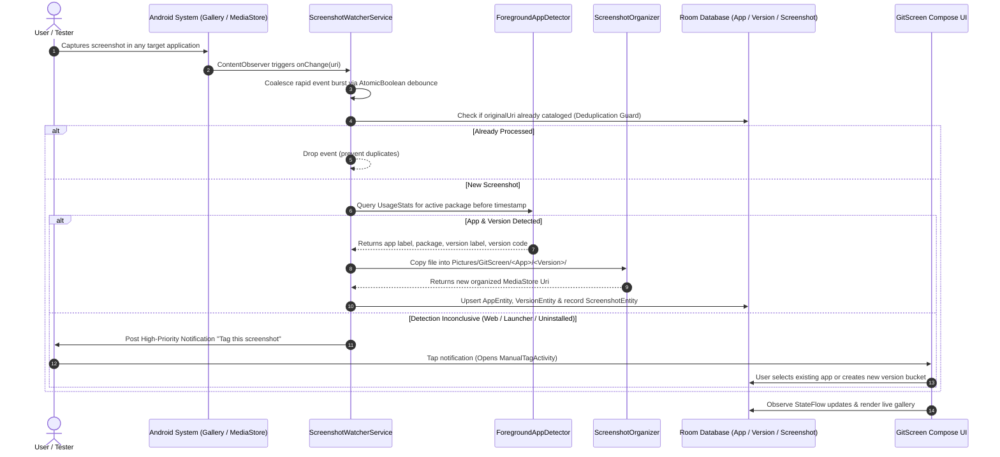

# GitScreen

<div align="center">


<p align="center">
  <strong>Git-like version tracking and automated visual organization for UI screenshots on Android.</strong>
</p>

[](https://hacktoberfest.com/)
[](#-track-alignment)
[](#-kiro-challenge-track-usage)

</div>

---

## 🧭 Track Alignment

This project is submitted to the **Hacktoberfest Hackathon NUST × NSTP** under:

- **Track 2: Developer Tools & Open-Source Infrastructure** *(Primary)*: Provides mobile software engineers and QA teams with automated tooling to track, categorize, and visually inspect UI evolution and regressions across builds without manual sorting.
- **Track 5: Productivity & Business Solutions** *(Secondary)*: Eliminates repetitive manual media file management, streamlining mobile design audits, bug reporting, and client review cycles.

---

## 🎯 Problem Statement

### The Problem
During rapid mobile development cycles, engineers, QA testers, and UI/UX designers take dozens—often hundreds—of device screenshots every sprint to document bugs, track UI transitions, verify localization, and compare design revisions.

However, modern mobile operating systems dump all captured screenshots into a single, unorganized folder (`Pictures/Screenshots` or DCIM) with arbitrary, non-descriptive filenames (e.g., `Screenshot_20261025_231841.png`). As a consequence:
1. **Zero Context**: Screenshots contain no metadata indicating what app was on screen, what feature was being verified, or what build version was active.
2. **Chaotic Gallery Clutter**: Work screenshots get mixed with personal media, making later retrieval time-consuming and frustrating.
3. **Difficult Visual Regression Audits**: Comparing the UI of "Version 1.0.0" against "Version 1.2.0" requires manually hunting through hundreds of unsorted images.

### Target Users
- **Android Developers**: Validating visual consistency across debug builds, feature branches, and release versions.
- **QA Engineers & Testers**: Capturing reproducible visual bug reports linked directly to the application package and version code.
- **UI/UX Designers & Product Managers**: Reviewing real-device UI evolutions and maintaining visual changelogs across sprint milestones.

---

## 💡 The Solution

**GitScreen** introduces **Git-like version control semantics to mobile screenshots**. 

Running silently in the background, GitScreen monitors new screenshot creations via a low-overhead foreground daemon. The moment a screenshot is taken, GitScreen:
1. **Auto-Detects the Foreground Application** at that precise millisecond using Android's `UsageStatsManager`.
2. **Extracts Build Metadata** (Application Name, Package Name, `versionName`, and `versionCode`) via `PackageManager`.
3. **Organizes the File into Scoped Storage** under `Pictures/GitScreen/<AppName>/<Version>/...` with clean timestamps.
4. **Catalogs the Capture in a Local Room Database** acting as a visual Git repository.
5. **Provides a Jetpack Compose Visual Browser** where screenshots are grouped into apps and version "branches" for instant visual comparison.
6. **Gracefully Falls Back to Manual Tagging** via an interactive notification when an untracked app or web prototype is captured.

---

## ✨ Key Features

- 🔍 **Automated Foreground App Heuristics**: Analyzes usage event windows to reliably determine the active foreground package right before the screenshot gesture completed.
- 🏷️ **Automated Version Branching**: Resolves semantic version strings (`1.0.0`, `2.1.0-beta`) directly from installed package manifests, grouping screenshots into version buckets.
- 📁 **Organized Scoped Media Storage**: Creates clean directories inside the standard Android `Pictures` directory using Android 10+ MediaStore scoped storage APIs.
- 🎨 **Jetpack Compose Material 3 UI**: Clean, dynamic-themed interface with dark/light mode, card summaries, version timelines, and image zoom grids.
- 🛡️ **Race-Condition & Deduplication Architecture**: Coalesces MediaStore event bursts using atomic boolean flags, coroutine `Mutex` serialization, and Room unique index constraints (`originalUri`).
- 🔔 **Manual Tagging Fallback with Direct Launch**: Displays a high-priority action notification when an app cannot be auto-detected, opening a dedicated lightweight `ManualTagActivity` to tag in seconds.
- 🔄 **Persistent Background Observer**: Foreground service (`ScreenshotWatcherService`) registered with `BOOT_COMPLETED` broadcast receiver to ensure continuous tracking across reboots.
- 🔒 **100% Offline & Private**: Zero network permissions requested. All metadata querying, file organizing, and database storage happens strictly on-device.

---

## 🛠️ Technology Stack

| Layer | Technology | Details |
|---|---|---|
| **Language** | Kotlin 1.9.24 | Idiomatic, coroutine-powered, type-safe development |
| **UI Framework** | Jetpack Compose (BOM 2024.06.00) | Declarative UI, Material 3 Design System, dynamic colors |
| **Architecture** | MVVM + Unidirectional Data Flow | ViewModel, StateFlow, CoroutineScope lifecycle management |
| **Local Database** | Room 2.6.1 + KSP | SQLite abstraction with foreign key cascades & unique indices |
| **Concurrency** | Kotlin Coroutines 1.8.1 | `Dispatchers.IO`, `SupervisorJob`, `Mutex` locks for file operations |
| **Image Loading** | Coil 2.6.0 | Fast, memory-efficient Compose image rendering |
| **System Services** | Android Platform APIs | `UsageStatsManager`, `ContentObserver`, `MediaStore`, Foreground Services |
| **Build System** | Gradle 8.11.1 (Kotlin DSL) | Android Gradle Plugin (AGP) 8.9.1 |
| **SDK Compatibility** | Min SDK 26 (Android 8.0) / Compile & Target SDK 36 | Full support for modern Android 14/15/16 Scoped Storage |

---

## 🤖 Kiro Challenge Track Usage

During the development of **GitScreen**, **Kiro** was utilized as an AI development accelerator across all phases of the project:

### 1. Architectural System Design
- **Entity-Relationship Modeling**: Used Kiro to model the relational hierarchy between `AppEntity`, `VersionEntity`, and `ScreenshotEntity` in Room, defining cascade delete behaviors and index constraints to avoid orphaned child entries.
- **MVVM Data Flow**: Formulated the unidirectional state pipeline where `ScreenshotRepository` exposes `Flow<List<AppSummary>>` and `Flow<List<ScreenshotEntity>>` directly to Compose ViewModels.

### 2. Solving Complex Concurrency & Race Conditions
- A single screenshot capture on modern Android triggers multiple rapid `onChange()` calls from `MediaStore` (file creation, metadata indexing, `IS_PENDING` flag toggle, thumbnail generation).
- With Kiro's analysis, we replaced an error-prone job cancellation approach with an **atomic debounced scheduling mechanism** (`AtomicBoolean` retrigger queue) paired with a coroutine `scanMutex`. This eliminated duplicate file copies and prevented missed scans.

### 3. Foreground App Detection Heuristic
- Standard Android screenshots carry no origin metadata. Kiro helped design the heuristic using `UsageStatsManager.queryEvents()` over a 15-second sliding time window, filtering out launcher interfaces (AOSP Launcher, Pixel Quickstep, SystemUI) to accurately identify the real target application.

### 4. Code Quality, Edge Cases & Documentation
- Designed edge-case recovery: ensuring that if a screenshot file copy fails, ghost database rows with 0 screenshots are never committed, plus a startup auto-cleanup routine (`cleanupEmptyEntries()`).
- Generated structured Open-Source documentation, issue templates, and architecture flowcharts for Hacktoberfest submission readiness.

---

## 🏗️ Architecture & Workflow

### Directory Structure

```
com.zivxio.gitscreen
├── GitScreenApp.kt         # Application entry point; initializes notification channels & Room DB
├── data
│   ├── db                  # Room database layer
│   │   ├── AppDatabase.kt  # Room database instance with fallback destructive migration
│   │   ├── Daos.kt         # AppDao, VersionDao, ScreenshotDao query interfaces
│   │   └── Entities.kt     # AppEntity, VersionEntity, ScreenshotEntity relational tables
│   └── repository          # Data orchestration & domain models
│       ├── Models.kt       # AppSummary, VersionSummary, DetectionResult data classes
│       └── ScreenshotRepository.kt # Central repository managing DB writes and query flows
├── detection               # Foreground application detection & scoped storage copy
│   ├── ForegroundAppDetector.kt  # UsageStatsManager heuristic & PackageManager resolution
│   └── ScreenshotOrganizer.kt    # Scoped MediaStore image copying to Pictures/GitScreen/...
├── service                 # Background daemon & event watchers
│   ├── BootReceiver.kt           # BOOT_COMPLETED receiver to restart watcher after reboot
│   ├── ScreenshotContentObserver.kt # MediaStore ContentObserver for new image notifications
│   └── ScreenshotWatcherService.kt  # Foreground service daemon with debounced scan pipeline
├── ui                      # Jetpack Compose UI presentation layer
│   ├── MainActivity.kt     # Main entry Activity hosting NavHost and permission checks
│   ├── ManualTagActivity.kt# Standalone lightweight activity for notification tag actions
│   ├── navigation
│   │   └── NavGraph.kt     # Compose Navigation graph (Home -> AppDetail -> VersionDetail)
│   ├── screens
│   │   ├── HomeScreen.kt          # App list, permission banner, thumbnail previews
│   │   ├── AppDetailScreen.kt     # Version list / branch overview for selected app
│   │   ├── VersionDetailScreen.kt # Responsive screenshot grid with full preview
│   │   └── ManualTagScreen.kt     # Manual app/version tagging interface with app chips
│   ├── theme
│   │   └── Theme.kt        # Material 3 dynamic color scheme, typography, shapes
│   └── viewmodel
│       └── ViewModels.kt   # HomeViewModel, AppDetailViewModel, VersionDetailViewModel, ManualTagViewModel
└── util                    # System utilities
    ├── NotificationHelper.kt # Foreground service notifications and prompt alerts
    └── Permissions.kt        # Storage, notification, and Usage Access permission verifiers
```

### System Sequence Diagram



---

## 🎬 Live Demonstration & Verification Guide

Judges and evaluators can verify GitScreen's core functionality in 4 simple steps:

### Test Case 1: Automatic Detection & Organization
1. **Launch GitScreen**: Grant standard gallery and notification permissions.
2. **Grant Usage Access**: Tap the on-screen banner to open Android System Settings and toggle **Usage Access** on for GitScreen.
3. **Take Screenshots**: Open any installed app on your device (e.g., Settings, Chrome, or any test app) and capture a screenshot.
4. **Verify in GitScreen**: Return to GitScreen. Notice that the app was automatically identified, its version cataloged, and the screenshot filed under a new version card with zero manual interaction!
5. **Verify in Files**: Open any file manager app. Check `Pictures/GitScreen/<AppName>/<Version>/` to confirm the organized copy.

### Test Case 2: Version Branching
1. Take multiple screenshots inside the same application.
2. Tap the application row in GitScreen to view the **App Detail Screen**.
3. Observe how screenshots are organized neatly under version branches (`v1.0.0`, `v2.0.0`), displaying exact screenshot counts.

### Test Case 3: Manual Fallback Tagging
1. Take a screenshot of the home screen or recents switcher where no third-party package is active.
2. Pull down the notification shade: notice the **"Couldn't identify the app"** notification prompt.
3. Tap the notification: `ManualTagActivity` opens showing the screenshot preview.
4. Type or select an app name, enter a version label (e.g., `Prototype-v1`), and tap **"Save to GitScreen"**.
5. The screenshot is immediately indexed and viewable under that custom bucket.

---

## 🔒 Permissions & Security

GitScreen is engineered strictly under **Zero-Trust Privacy** principles:

| Permission | Technical Requirement |
|---|---|
| `READ_MEDIA_IMAGES` / `READ_EXTERNAL_STORAGE` | Detects newly captured screenshots in the Android media store. |
| `POST_NOTIFICATIONS` | Displays the persistent background service status and manual tagging prompts (Android 13+). |
| `PACKAGE_USAGE_STATS` (Special Usage Access) | Granted by the user in Settings to query the last foreground app transition via `UsageStatsManager`. |
| `FOREGROUND_SERVICE` & `FOREGROUND_SERVICE_DATA_SYNC` | Keeps the ContentObserver alive in background memory without being killed by Android battery optimizers. |
| `RECEIVE_BOOT_COMPLETED` | Automatically restarts the screenshot watcher when the device boots up. |

> 🛡️ **Privacy & Responsible Development**: GitScreen requires **NO internet access** (`android.permission.INTERNET` is deliberately omitted). All images, metadata, and database records remain 100% on the user's physical device. No telemetry, credentials, or private data are ever stored or transmitted.

---

## 🚀 Getting Started

### Prerequisites
- **Android Studio**: Ladybug (2024.2.1) or newer
- **JDK**: Java 17 or higher
- **Android Device / Emulator**: Running Android 8.0 (API 26) through Android 16 (API 36)

### Installation & Build

1. **Clone the Repository**:
   ```bash
   git clone https://github.com/hashamtanveer-41/GitScreen.git
   cd GitScreen
   ```

2. **Open in Android Studio**:
   - Open Android Studio, select **Open**, and navigate to the cloned `GitScreen` folder.
   - Allow Gradle to sync dependencies and build indexing.

3. **Assemble Debug APK**:
   ```bash
   ./gradlew assembleDebug
   ```

4. **Install on Device / Emulator**:
   ```bash
   ./gradlew installDebug
   ```

---

## 👥 Team Members & Contributions

Submitted by **Hasham Tanveer** for **Hacktoberfest Hackathon NUST × NSTP 2026**:

| Contributor | Role | Core Contributions |
|---|---|---|
| **Hasham Tanveer**<br>([@hashamtanveer-41](https://github.com/hashamtanveer-41)) | Lead Developer & Architect | • Overall system architecture and data modeling.<br>• Implementation of `ForegroundAppDetector` heuristic and `ScreenshotOrganizer` scoped storage logic.<br>• Background service lifecycle, ContentObserver debouncing, and `BootReceiver`.<br>• Room Database schema, DAOs, and repository orchestration.<br>• Material 3 Jetpack Compose UI (HomeScreen, DetailScreen, ManualTag flow).<br>• Comprehensive documentation, open-source governance, and test guides. |

---

## 💖 Acknowledgements & Open-Source Credits

GitScreen proudly stands on the shoulders of the open-source community:

- **[Android Jetpack & Jetpack Compose](https://developer.android.com/jetpack/compose)**: Modern declarative UI toolkit for Android.
- **[AndroidX Room Database](https://developer.android.com/training/data-storage/room)**: Robust SQLite object-mapping library with KSP compiler support.
- **[Kotlin Coroutines & Flow](https://github.com/Kotlin/kotlinx.coroutines)**: Asynchronous and concurrent programming foundation.
- **[Coil (Coroutine Image Loader)](https://coil-kt.github.io/coil/)**: Lightweight, high-performance image loading library for Android Compose.
- **[Material Design 3](https://m3.material.io/)**: Modern design system and accessible component library.

---

## 📄 License

This project is licensed under the **[MIT License](LICENSE)** — see the [LICENSE](LICENSE) file for complete details. Open-sourced with ❤️ for Hacktoberfest.