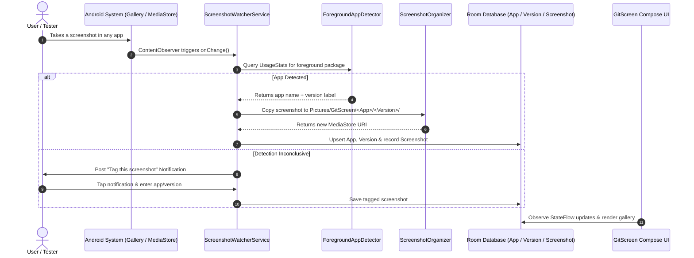

# GitScreen

<div align="center">


<p align="center">
  <strong>Git-like version tracking and automated organization for UI screenshots on Android.</strong>
</p>

</div>

---

## 📌 Overview

**GitScreen** brings version-control semantics to mobile screenshots. Designed for mobile app developers, UI/UX designers, and QA engineers, GitScreen automatically detects which application was in the foreground when a screenshot was taken, extracts its version metadata, and organizes the image into a clean, structured directory hierarchy (`Pictures/GitScreen/<AppName>/<Version>/...`).

Inside the GitScreen app, screenshots are presented like Git branches and releases, making visual regression tracking, design changelogging, and UI audit workflows effortless.

---

## ✨ Features

- 🔍 **Automated Foreground App Detection**: Leverages Android's `UsageStatsManager` event pipeline to accurately pinpoint which app was active on screen at the millisecond the screenshot was captured.
- 🏷️ **Smart Version Tagging**: Automatically resolves app package info, display names, and semantic version numbers (`versionName` / `versionCode`) using `PackageManager`.
- 📁 **Organized Scoped Storage**: Uses Android Scoped Storage (`MediaStore`) to save copies into structured directories (`Pictures/GitScreen/<AppName>/<Version>/...`) without cluttering your original gallery.
- 🎨 **Modern Jetpack Compose UI**: Built with Material 3 design, supporting dynamic color theming, fluid animations, and dark mode.
- 📊 **App & Version Browser**: Visual cards displaying tracked apps, version counts, total screenshots, and high-resolution thumbnail previews.
- 🛡️ **Race-Condition & Deduplication Guards**: Background ContentObserver debouncing, coroutine `Mutex` locking, and Room unique index constraints prevent duplicate files and ghost entries.
- 🔔 **Manual Tagging Fallback**: If an app cannot be auto-detected (e.g., prototype web views or launcher screens), a high-priority notification lets you tag the screenshot with a single tap via `ManualTagActivity`.
- 🔄 **Persistent Background Service**: Long-running `ScreenshotWatcherService` running as an unobtrusive foreground service, auto-restarted on device reboot via `BootReceiver`.

---

## 🏗️ Architecture & Tech Stack

GitScreen is built following modern Android architectural guidelines (MVVM, Clean Architecture, Unidirectional Data Flow):

```
com.zivxio.gitscreen
├── data
│   ├── db                  # Room database entities, DAOs, and database provider
│   │   ├── AppDatabase.kt
│   │   ├── Daos.kt
│   │   └── Entities.kt
│   └── repository          # Domain models and ScreenshotRepository data coordinator
│       ├── Models.kt
│       └── ScreenshotRepository.kt
├── detection               # Foreground app detection and media file organization
│   ├── ForegroundAppDetector.kt
│   └── ScreenshotOrganizer.kt
├── service                 # Background daemon, ContentObserver, and Boot receiver
│   ├── BootReceiver.kt
│   ├── ScreenshotContentObserver.kt
│   └── ScreenshotWatcherService.kt
├── ui                      # Jetpack Compose UI layer
│   ├── navigation          # Compose NavGraph and route definitions
│   │   └── NavGraph.kt
│   ├── screens             # HomeScreen, AppDetailScreen, VersionDetailScreen, ManualTagScreen
│   │   ├── AppDetailScreen.kt
│   │   ├── HomeScreen.kt
│   │   ├── ManualTagScreen.kt
│   │   └── VersionDetailScreen.kt
│   ├── theme               # Material 3 Color schemes and Theme wrapper
│   │   └── Theme.kt
│   ├── viewmodel           # AAC ViewModels with StateFlow and CoroutineScope
│   │   └── ViewModels.kt
│   ├── MainActivity.kt     # App entry activity hosting Compose Navigation
│   └── ManualTagActivity.kt# Lightweight direct-launch activity for notification tagging
├── util                    # System permissions and notification helpers
│   ├── NotificationHelper.kt
│   └── Permissions.kt
└── GitScreenApp.kt         # Application entry point initializing channels & database
```

### Core Technologies
- **Language**: Kotlin 1.9.24
- **UI**: Jetpack Compose (Compose BOM 2024.06.00) + Material 3
- **Local Database**: Room 2.6.1 + KSP (Kotlin Symbol Processing)
- **Asynchronous Flow**: Kotlin Coroutines 1.8.1 & StateFlow / Flow
- **Image Loading**: Coil 2.6.0
- **Storage**: MediaStore Scoped Storage API (`IS_PENDING` workflow for Android 10+)
- **Minimum SDK**: Android 8.0 (API 26)
- **Target SDK**: Android 15 / 16 (API 36)

---

## 🔄 How It Works



---

## 🔒 Permissions & Security

GitScreen requires specific system permissions to monitor screenshots and identify running apps:

| Permission | Purpose |
|---|---|
| `READ_MEDIA_IMAGES` / `READ_EXTERNAL_STORAGE` | Detects newly captured screenshots in the device gallery. |
| `POST_NOTIFICATIONS` | Displays the persistent background service status and manual tagging prompts. |
| `PACKAGE_USAGE_STATS` (Usage Access) | Special permission granted via System Settings to inspect recent foreground app transitions. |
| `FOREGROUND_SERVICE` & `FOREGROUND_SERVICE_DATA_SYNC` | Keeps the MediaStore observer active in background without being terminated by OS battery optimizers. |
| `RECEIVE_BOOT_COMPLETED` | Automatically resumes the watcher service when your device boots up. |

> ℹ️ **Privacy Guarantee**: All processing happens 100% locally on your device. GitScreen has no network permissions (`INTERNET` permission is omitted) and transmits no telemetry or image data.

---

## 🚀 Getting Started

### Prerequisites
- **Android Studio**: Ladybug (2024.2.1) or newer
- **JDK**: Java 17 or higher
- **Android Device / Emulator**: Running Android 8.0 (API 26) or higher

### Building from Source

1. Clone the repository:
   ```bash
   git clone https://github.com/hashamtanveer-41/GitScreen.git
   cd GitScreen
   ```

2. Open the project directory in **Android Studio**.

3. Let Gradle sync dependencies and build tools.

4. Build the debug APK using Gradle:
   ```bash
   ./gradlew assembleDebug
   ```

5. Install and launch on your connected Android device or emulator:
   ```bash
   ./gradlew installDebug
   ```

### Initial Device Configuration
1. Open GitScreen on your device.
2. Grant the standard gallery and notification permissions when prompted.
3. Tap **"Grant Usage Access"** on the banner to navigate to Android System Settings, and toggle access on for GitScreen.
4. Take a screenshot of any installed app — GitScreen will automatically capture and catalog it!

---

## 📄 License

This project is licensed under the [MIT License](LICENSE) - see the [LICENSE](LICENSE) file for details.